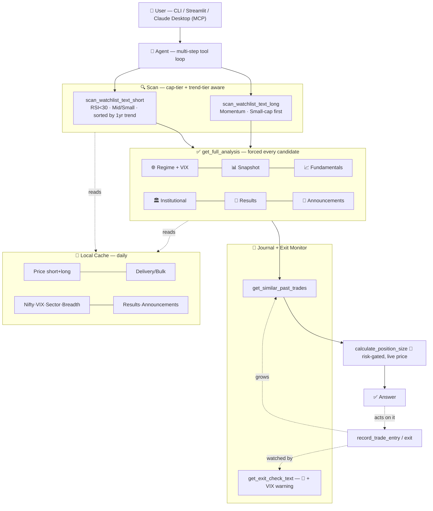

# 📈 NSE Momentum & Swing Trading Assistant

> A personal AI-powered research tool for Indian NSE stocks — combining backtested quantitative strategies stratified by market cap AND trend context, institutional flow data, real-time news/announcements, market regime, a growing personal trade journal, active exit monitoring, and a multi-interface LLM agent (CLI, Streamlit, MCP/Claude Desktop) with enforced risk controls.


---

## ⚠️ Read this first

**This is a research and decision-support tool. It does not place trades, and it is not financial advice.** Every strategy in this repo was built the honest way: hypothesize → backtest against a random-entry control → only keep what survives. Where a signal didn't survive that test, this README says so plainly. The tool's job is to organize real data, enforce risk discipline, and remember your own trading history — the trading decision is always yours.

**Regulatory note**: this tool is not, and does not claim to be, SEBI-registered investment advice. It is a personal research aid.

---

## 🧠 What this actually is

Every strategy here was validated against **5 years of data across a 748-stock NSE universe**, benchmarked against a random-entry control, then **re-tested stratified by market-cap segment AND 1-year trend context** to check whether the edge actually holds where the tool applies it — not just assumed. Refinements that didn't hold up (like excluding "deep pullback" stocks) are documented as honestly as the ones that did.

---

## 📊 The two validated strategies

### 🔹 Short-term Swing (4–6 days)

| | |
|---|---|
| **Signal** | RSI < 30 (oversold), Mid/Small-cap, **≥ ₹25 cr median daily turnover** |
| **Exit** | 2× ATR stop-loss / 2×–3.5× ATR targets, 6-day time exit |
| **Backtest** | 702 stocks, 5 years, non-overlapping trades, **net of Indian transaction costs** |

#### ⚠️ Corrected statistics (2026-07)

The original z-scores were inflated by **overlapping trades** — RSI stays below 30 for several
consecutive days, so one oversold episode was counted as ~3.4 near-identical trades sharing the
same forward returns, while the standard error was computed as if they were independent
(López de Prado, *Advances in Financial ML* ch.4 — sample uniqueness). Measured label
uniqueness on this universe: **0.344**. All figures below are re-measured with non-overlapping
trades, gap-through-stop fills, and costs charged.

#### ⚠️ Second correction (2026-08): day-clustering

The overlap fix above corrected trades that overlapped **within one stock**. It did not correct
trades that cluster **across stocks on the same day** — when the market is broadly oversold,
hundreds of names trigger together and their forward returns share one market factor, so they
are not independent observations either. `z_paired` re-tests each day's strategy mean against
the **same day's** random-entry control, which nets out that shared move (`backtest_engine.py`
→ `day_clustered_edge`, re-run by `backtest_day_clustered.py`).

| Segment | Published z | Corrected z | **z_paired** | Net/trade | Verdict |
|---|---|---|---|---|---|
| Small-cap | 12.06 | 7.03 | **2.74** | +0.53% | ✅ Real |
| Mid-cap | 5.65 | 5.20 | **1.73** | +0.69% | ⚠️ No longer demonstrated |
| Large-cap | 1.29 | 0.55 | **−0.04** | −0.02% | ❌ No edge — excluded |

**Stratified by 1-year trend context:**

| Trend tier | Published z | Corrected z | **z_paired** | Net/trade | Verdict |
|---|---|---|---|---|---|
| Uptrend (>+20% 1yr) | 12.48 | 7.58 | **2.05** | +1.33% | ✅ Highest return, lower certainty |
| Flat/Mild | 5.84 | 5.42 | **4.41** | +0.47% | ✅ Most statistically reliable |
| Downtrend (<−20% 1yr) | 4.19 | 3.18 | **0.71** | +0.24% | ❌ Gone — not distinguishable from random |

> 🔄 **The tier ordering partly inverts.** Uptrend still earns the most per trade (+1.23% vs
> +0.59% re-measured), but Flat/Mild is the more statistically reliable tier. Both hold: Uptrend
> fires on fewer days (306 vs 431) with fewer names per day, so its day-means are noisier. Read
> it as *higher-return but less certain*, not *Flat is better* — the scan's Uptrend-first sort is
> unchanged.

> ⚖️ **What day-clustering does not prove.** The paired test loses power when a strategy fires on
> few names per day: Mid-cap averages 3.1 trades/day against Small-cap's 7.8, so part of its drop
> is statistical power rather than absent edge. Mid-cap is **no longer demonstrated, not
> disproven**. Day-clustering is the conservative bound — the truth sits between it and the
> trade-level number. It is the right default here only because the optimistic version has
> already been wrong twice on this project.

**Survived the correction intact**: oversold depth is still monotonic in net return
(RSI<24 +1.17% → 30–35 +0.10%), and the ≥₹25cr liquidity filter still earns its place
(z_paired 3.28 filtered vs 2.64 unfiltered). Full detail in `day_clustered_results.md`.

#### 💰 Costs are not optional

Backtests previously charged **zero** transaction costs. On a 4–6 day mid/small-cap hold, the
Indian cost stack (STT, brokerage, exchange/SEBI fees, GST, stamp duty, plus slippage and
liquidity-scaled impact) is the *same order of magnitude as the edge itself*. Applied across the
unfiltered Mid/Small universe, the strategy is roughly break-even.

#### 🌊 Liquidity: the edge is strongest in the MOST liquid names

Counter to the usual illiquidity-premium intuition, gross edge rises monotonically with turnover
— and illiquid names simultaneously carry ~3× the impact cost. They are net-negative.

| 60-day median turnover | Gross/trade |
|---|---|
| ≤ ₹10 cr | +0.53% |
| ≤ ₹19 cr | +0.71% |
| ≤ ₹37 cr | +0.72% |
| ≤ ₹91 cr | +1.00% |
| ≤ ₹874 cr | +1.11% |

**Validated by 5-fold chronological walk-forward** with point-in-time turnover (no look-ahead):
the ≥₹25 cr universe beat the unfiltered one in **all 5 folds** (+0.564% vs +0.259% net per
trade). Survives a Deflated Sharpe test across the full 20-config search (noise-ceiling SR 0.54
vs observed 1.15), so it is not a multiple-testing artifact.

#### 📉 Edge scales with oversold depth (monotonic — no fitted optimum)

| RSI band | Gross/trade | Net/trade |
|---|---|---|
| < 24 | +1.67% | **+1.17%** |
| 24–26 | +1.27% | +0.77% |
| 26–28 | +1.00% | +0.50% |
| 28–30 | +0.77% | +0.27% |
| 30–35 | +0.60% | +0.10% (barely clears costs) |

The scan threshold stays at Wilder's pre-committed **RSI < 30** — it was never optimized, so it
carries no search-selection bias — but results are now **sorted by net expected value**, so
deeper-oversold, more-liquid names surface first.

> 🔬 **Tested and *not* adopted**: within Uptrend stocks, we hypothesized "shallow pullback near highs" would beat "deep pullback below 50-day high" — the data said the opposite (deep pullback z=12.53 vs shallow z=0.51, only 45 samples). This is simply what an RSI<30 reading structurally looks like; not a real distinct edge. Documented so future-us doesn't re-test it.

> 🚨 **Most recent 12 months were negative** across *every* configuration tested. Could be
> regime, decay, or noise — but it is real, and the 5-year average hides it. This is what the
> CUSUM decay monitor exists to catch.

#### 🌪️ Market volatility regime — the opposite of textbook vol-targeting

Mean reversion needs panic to revert from. In a calm market an RSI<30 reading is more often
something genuinely wrong with the stock than a market overreaction. Measured over 5 years,
**point-in-time** trailing-252d volatility percentile, net of costs (n=2,959, z=9.27):

| Market vol percentile at entry | Net/trade | Win rate |
|---|---|---|
| calmest 25% | **−0.81%** | 42.3% |
| 25–50% | **−0.78%** | 44.4% |
| 50–75% | +0.53% | 56.4% |
| most volatile 25% | **+1.64%** | 62.2% |

Position sizing now scales risk **down in calm markets** (to 25–35% of requested) and allows
full size only in the top volatility quartile. Note this inverts standard volatility
targeting, which is written for trend-following — per-trade stock volatility is already
handled separately, since size is `risk / (2 × ATR)`.

#### 🎯 Meta-labeling — replacing the dead XGBoost

The original models predict the *size* of the next move and score R² ≈ 0. That is not a
tuning failure: expected returns are tiny next to their own noise, so magnitude is close to
unlearnable. Meta-labeling asks an easier, directly useful question instead — *given the
signal fired, what is P(this trade ends profitable)?*

Purged, chronological cross-validation (AUC **0.587**, positive in all 4 folds):

| Selection | Trades | Net/trade | Win rate |
|---|---|---|---|
| take all (baseline) | 2,264 | +0.46% | 53.0% |
| top 75% by P(win) | 1,696 | +0.87% | 56.2% |
| top 50% by P(win) | 1,132 | **+1.32%** | 59.5% |
| top 25% by P(win) | 568 | **+1.75%** | 62.1% |

Monotonic and out-of-sample. `P(win)` now appears per candidate in scans. The old
`Model signal %` remains visible but de-emphasised — the two must not be confused.

#### 🚦 Is the edge still there?

Chronological attribution against the random-entry control, 5-year, net of costs:

| Period | Strategy | Control | Edge | **z_paired** |
|---|---|---|---|---|
| 2021-10 → 2022-12 | +0.79% | −0.68% | +1.47% | 1.65 |
| 2022-12 → 2024-09 | +1.03% | +0.35% | +0.69% | 1.67 |
| 2024-09 → 2025-02 | +0.67% | −0.23% | +0.90% | 3.20 |
| 2025-02 → 2025-12 | +0.84% | −0.60% | +1.44% | 1.49 |
| **2025-12 → 2026-07** | **−0.68%** | **−0.46%** | **−0.22%** | **−0.57** |

> Day-clustered, only one of the four "good" periods clears z=2 on its own. Each period is a
> short window, so this is partly power — but it means the per-period edges were never as
> firmly established as the trade-level numbers implied. The final period's collapse is
> confirmed either way.

**Verdict: EDGE LOST** — real for four years (+1.13% edge, z≈9), now statistically
indistinguishable from zero (z = −0.10, p = 0.92). The random control *also* fell, which is
consistent with a harder market rather than only a broken signal — but one period cannot
separate decay from regime, and `decay_monitor.py` deliberately refuses to guess. The live
CUSUM alarm is not raised (10% of trigger). Trade smaller until this resolves.

### 🔹 Long-term Position (~1 month)

| | |
|---|---|
| **Signal** | Near 52-week high + confirmed uptrend (Price > SMA50 > SMA200) — **momentum**, not mean-reversion |
| **Exit** | Fixed −8% stop-loss / +16% target |

| Segment | Published z | Status |
|---|---|---|
| Small-cap | 14.52 | ⏳ Not yet re-validated |
| Mid-cap | 2.88 | ⏳ Not yet re-validated — likely fails once overlap is corrected |
| Large-cap | 2.28 | ⏳ Not yet re-validated — likely fails once overlap is corrected |

> ⚠️ The long-term figures are still the **original, overlap-inflated** numbers. They have not
> yet been re-run through `backtest_engine.py`. Treat them as provisional.

> 🚫 RSI-oversold at the 1-month horizon *underperformed* random (z=-2.98) — mean-reversion and momentum are opposite effects at different horizons.

---

## 🛠️ Feature set

- ✅ Dual-horizon scanning, market-cap AND trend-tier aware, across 748 stocks
- ✅ Relative strength vs Nifty 50 and sector peers
- ✅ Market regime: breadth, Nifty trend, India VIX — forced cross-signal reasoning
- ✅ Fundamentals with deterministic threshold labels (no LLM-narrated inconsistency)
- ✅ Institutional footprint: delivery % trend, bulk/block deals
- ✅ **Real-time corporate announcements** — actual NSE filing text (`attchmntText`), not just category labels; catches events like management changes same-day
- ✅ **News sentiment assessment** — agent explicitly labels headline tone, grounded only in real fetched text
- ✅ Earnings calendar, sector-aware ("upcoming catalysts" scan)
- ✅ Verified company descriptions, explicit anti-hallucination rules
- ✅ Code-enforced risk gates — blocks >2% risk or parabolic setups until explicit confirmation
- ✅ **Live price bypass** — position sizing and exit checks use real-time quotes, not cache-lagged prices
- ✅ 📓 Personal trade journal — frozen entry snapshots, honest small-sample retrieval
- ✅ 🚦 **Active exit monitoring** — validated stop/target/time-exit rule + VIX-spike early warning
- ✅ 🕘 Persistent chat history (Streamlit) — resumable, deletable
- ✅ **Multi-interface**: CLI, Streamlit browser UI, and **MCP server** (Claude Desktop, potentially other MCP clients)
- ✅ Provider-agnostic (Groq, DeepSeek, Anthropic, local Ollama, self-hosted)
- ✅ Local caching layer, refreshed daily

---

## 🏗️ Architecture



## 📁 Project structure

trading-assistant/
├── config.py # watchlist, cap-bucket map, providers, risk defaults
├── data_fetcher.py # short-term features (RSI, MACD, ATR, 1yr trend), live price
├── data_fetcher_long.py # long-term features, fundamentals
├── cache_manager.py # cache: price, delivery, bulk, Nifty, VIX, sector RS, breadth, results, announcements
├── trade_journal.py # trade log: entry/exit, similarity, exit monitoring
├── build_universe.py # one-time: 748-stock universe with market-cap ranks
├── model_trainer_short.py # short-term XGBoost
├── model_trainer_long.py # long-term XGBoost
├── refresh_cache.py # run daily
├── tools.py # all agent tools + risk-gating + labeling logic
├── agent.py # Groq/OpenAI-compatible agent loop (CLI/Streamlit)
├── mcp_server.py # MCP server (Claude Desktop / other MCP clients)
├── main.py # CLI
├── app.py # Streamlit UI + persistent chat history
├── conversations/ # saved Streamlit chat threads
├── nse_watchlist_expanded.csv # 748-stock universe, cap-bucket tags
├── trade_log.csv # personal trade history
├── requirements.txt
├── trading_model_short.pkl
└── trading_model_long.pkl


---

## 🚀 Quick start

```bash
git clone <this-repo-url>
cd trading-assistant
python -m venv venv
venv\Scripts\activate
pip install -r requirements.txt
```

`.env`: `GROQ_API_KEY=your_key_here`

First-time: `python build_universe.py` → `python model_trainer_short.py` → `python model_trainer_long.py` → `python refresh_cache.py`

Daily: `python refresh_cache.py`, then `python main.py` / `streamlit run app.py` / Claude Desktop (see MCP setup below)

---

## 🔧 The 18 agent tools

| Category | Tool | What it does |
|---|---|---|
| Scan | `scan_watchlist_text_short` | RSI<30, Mid/Small-cap only, sorted by 1yr trend tier (Uptrend→Flat→Downtrend) |
| Scan | `scan_watchlist_text_long` | Momentum candidates, all caps, Small-cap surfaced first |
| Scan | `get_catalyst_scan_text` | UNVALIDATED: unusual volume spikes across the whole watchlist |
| Analysis | `get_snapshot_text_short` / `_long` | Full technical snapshot for one stock |
| Analysis | `get_full_analysis` | **Forces** the complete checklist — regime, snapshot, fundamentals, institutional, results, announcements |
| Analysis | `get_fundamentals_text` | P/E, growth, margins, ROE, debt — deterministic labels, verified business description |
| Analysis | `get_institutional_activity_text` | 30-day delivery % trend, bulk/block deals |
| Analysis | `check_upcoming_results` | Upcoming earnings/board meetings for one stock |
| Analysis | `get_upcoming_catalysts_scan` | Whole-watchlist results calendar, with sector momentum context |
| Analysis | `get_market_regime_text` | Market breadth, Nifty trend, India VIX |
| Analysis | `get_significant_announcements_scan` | Whole-watchlist high-signal corporate announcements (management changes, M&A, takeovers) |
| Analysis | `get_recent_announcements_text` | All recent announcements for one stock, with real NSE filing detail text |
| Analysis | `get_announcement_reaction_text` | Real observed price move since a stock's most recent announcement |
| Analysis | `get_live_price_text` | Real-time quote, bypasses any cache lag |
| Risk | `calculate_position_size` | Share count via live price — **blocks** above 2% risk or on parabolic setups |
| 📓 Journal | `record_trade_entry` / `record_trade_exit` | Logs real entries/exits, freezes full signal snapshot |
| 📓 Journal | `get_open_positions` | Lists currently open logged trades |
| 📓 Journal | `get_similar_past_trades` | Real historical outcomes for a similar setup, honest sample-size caveats |
| 🚦 Monitor | `get_exit_check_text` | Checks open positions against validated stop/target/time-exit + VIX-spike warning |

---

## 🧩 Interfaces

- **CLI**: `python main.py` — always picks up latest code automatically
- **Streamlit**: `streamlit run app.py` — **needs manual restart** after any code change
- **MCP / Claude Desktop**: `mcp_server.py`, connected via `claude_desktop_config.json` pointing at `venv\Scripts\python.exe` — runs as a **persistent background process**; needs a **full Claude Desktop quit (system tray) + reopen** after any code change, not just a window close

---

## 📓 The trade journal, explained

Not a vector-search "RAG" system — simpler and more honest than that. Trades are structured data (ticker, entry signals, outcome), so retrieval is plain filtering, not semantic search:

1. You tell the agent when you enter a real trade → it freezes the exact signal state permanently
2. You tell it when you exit → it computes the real return and closes the record
3. Before any future recommendation, it automatically pulls your past trades matching a similar profile — **always with an explicit caveat when the sample is still small** (under 10 = anecdotal, under 30 = early signal)

This is what eventually tells you whether the backtested edge survives contact with your own real execution, timing, and costs.

---

## 🛑 Honest limitations

- XGBoost model signals are weak (R² near zero) — never the basis of a recommendation
- **Survivorship bias is not corrected.** The 748-stock universe is built from stocks listed
  *today*, so names that delisted or collapsed during the backtest window are simply absent.
  This inflates every historical result here by an unmeasured amount.
- Transaction costs, slippage and liquidity-scaled impact **are** charged (see *Costs are not
  optional*) — this was previously listed as a limitation and is now fixed
- **Day-clustered inference is the conservative bound, not the truth.** It loses power when a
  strategy fires on few names per day, so a stratum that fails it is *not demonstrated*, not
  disproven. The real figure sits between it and the trade-level number
- Sector RS, Nifty RS, breadth, VIX are informed context, not independently re-backtested compound conditions
- News/announcement signals cannot be backtested at all (no historical news archive) — explicitly real-time-only
- Yahoo's NSE data can lag 10+ hours after close on some days — mitigated via live-price bypass for anything time-sensitive
- Trade journal stats are anecdotal until real volume accumulates — the tool says so explicitly

---

## 🙏 Inspiration & credits

[HKUDS/Vibe-Trading](https://github.com/HKUDS/Vibe-Trading) · [AI4Finance-Foundation](https://github.com/AI4Finance-Foundation) · [microsoft/qlib](https://github.com/microsoft/qlib) · [Fincept-Corporation/FinceptTerminal](https://github.com/Fincept-Corporation/FinceptTerminal)

---

## 📜 Disclaimer

Personal research and education only. Not financial advice. Not SEBI-registered. Trading carries real risk of loss. Paper trade before risking real capital.

---

*Built iteratively, backtested honestly, one validated signal at a time.*