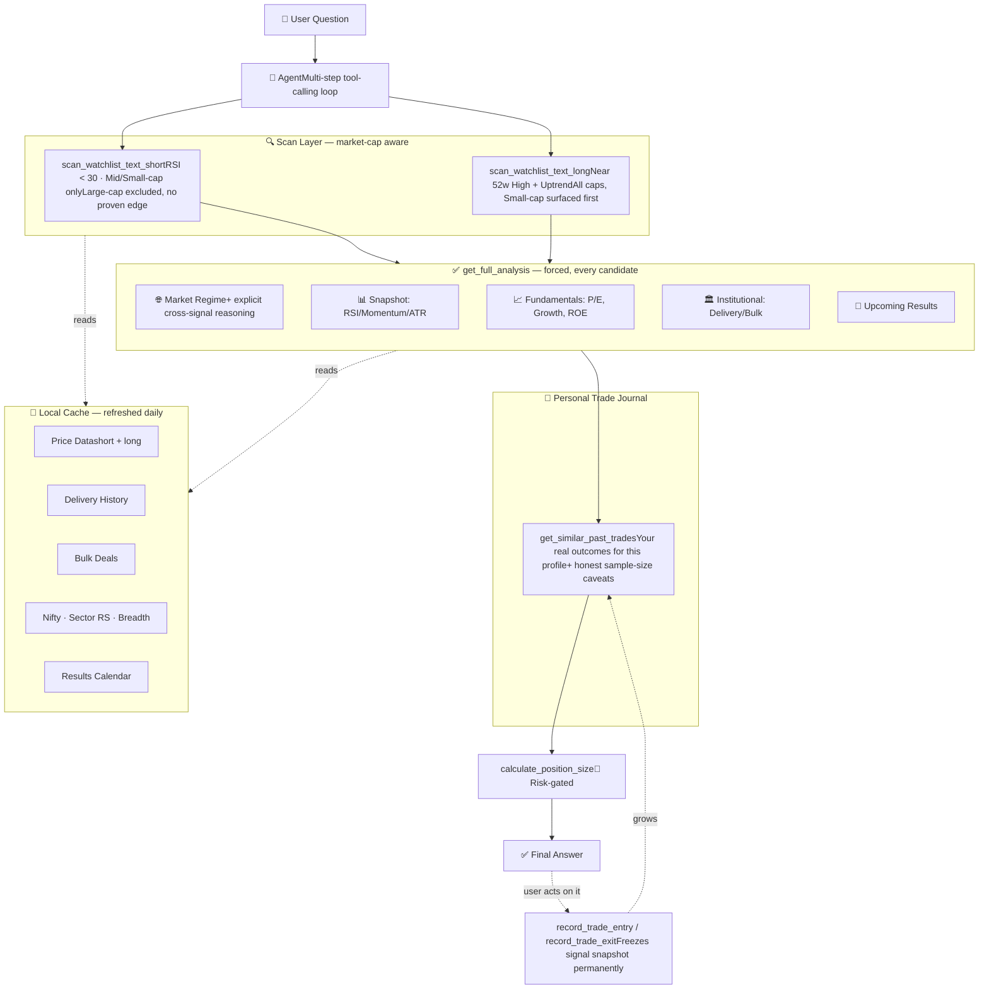

# 📈 NSE Momentum & Swing Trading Assistant

> A personal AI-powered research tool for Indian NSE stocks — combining backtested quantitative strategies stratified by market cap, institutional flow data, fundamentals, market regime context, a growing personal trade journal, and an LLM agent with enforced risk controls.


---

## ⚠️ Read this first

**This is a research and decision-support tool. It does not place trades, and it is not financial advice.** Every strategy in this repo was built the honest way: hypothesize → backtest against a random-entry control → only keep what survives. Where a signal didn't survive that test, this README says so plainly. The tool's job is to organize real data, enforce risk discipline, and remember your own trading history — the trading decision is always yours.

---

## 🧠 What this actually is

Most "AI trading bot" projects skip the part where you check if the idea works before building around it. This one doesn't. Every strategy here was validated against **5 years of data across a 748-stock NSE universe**, benchmarked against a random-entry control group, then **re-tested stratified by market-cap segment** (SEBI's official Large/Mid/Small classification) to check whether the edge actually holds where the tool applies it — not just assumed.

The result: two independently validated trading strategies, correctly scoped to the market-cap segments where they're proven to work, wrapped in a multi-tool LLM agent that enforces risk rules in code, and backed by a permanent personal trade journal that grounds every future recommendation in your own real, lived outcomes — not just historical backtests.

---

## 📊 The two validated strategies

### 🔹 Short-term Swing (4–6 days)
| | |
|---|---|
| **Signal** | RSI < 30 (oversold) |
| **Exit** | 2× ATR stop-loss / 2×–3.5× ATR targets |
| **Backtest** | 748 stocks, 5 years, 30,000+ simulated trades |
| **Edge vs random entry** | +0.60% per trade (Small-cap) |

**Stratified by market cap:**
| Segment | Z-score | Verdict |
|---|---|---|
| Small-cap | **12.06** | ✅ Strongest, primary hunting ground |
| Mid-cap | 5.65 | ✅ Real edge |
| Large-cap | 1.29 | ❌ **No reliable edge — auto-excluded by default** |

### 🔹 Long-term Position (~1 month)
| | |
|---|---|
| **Signal** | Near 52-week high + confirmed uptrend (Price > SMA50 > SMA200) — a **momentum**, not mean-reversion, strategy |
| **Exit** | Fixed -8% stop-loss / +16% target |
| **Backtest** | 748 stocks, 5 years, 180,000+ simulated trades |

**Stratified by market cap:**
| Segment | Z-score | Verdict |
|---|---|---|
| Small-cap | **14.52** | ✅ Dominant edge, shown first |
| Mid-cap | 2.88 | ✅ Real, weaker |
| Large-cap | 2.28 | ✅ Real, weakest — still included, sorted last |

> 🚫 **What got tested and rejected**: RSI-oversold at the 1-month horizon *actively underperformed* random entries (z-score **-2.98**). Mean-reversion and momentum are close to opposite effects at different horizons — proven with real data, not assumed.

> 📐 **Why market-cap stratification matters**: A signal that works on 250 microcaps doesn't automatically work on the Nifty 500's blue-chips too efficiently priced by institutions for a simple RSI dip to reliably bounce. Rather than guess, both strategies were re-tested per segment (SEBI ranking: Large=1–100, Mid=101–250, Small=251+) before trusting them on the expanded universe.

---

## 🛠️ Feature set

- ✅ **Dual-horizon scanning** across a 748-stock universe (Nifty 500 + Microcap 250, officially indexed, real tradable businesses)
- ✅ **Market-cap-aware defaults** — short-term auto-excludes the segment proven not to work; long-term surfaces the strongest segment first
- ✅ **Relative strength vs Nifty 50** — filters out stocks just riding a broad market rally
- ✅ **Sector-relative strength** — filters out stocks just riding a sector-wide rally
- ✅ **Market regime & breadth check** — the agent is required to explicitly reason across regime and stock-level signals, not report them as disconnected sections
- ✅ **Fundamentals** (P/E, revenue/earnings growth, margins, ROE, debt) — free via yfinance, with **deterministic threshold labels** (no LLM-narrated inconsistency)
- ✅ **Institutional footprint** — 30-day delivery % trend + bulk/block deal tracking, straight from NSE
- ✅ **Earnings calendar awareness** — flags upcoming results that could gap through a stop-loss
- ✅ **Verified company descriptions** — pulled from real filings, with an explicit anti-hallucination rule
- ✅ **Code-enforced risk gates** — blocks position sizing above 2% risk or on parabolic setups until explicitly overridden
- ✅ **📓 Personal trade journal** — every real entry/exit is logged with a frozen snapshot of all signals present at the time; future recommendations automatically pull your own past outcomes for similar setups, with honest small-sample-size warnings until there's real volume
- ✅ **Multi-step agentic reasoning** — chains tool calls automatically (scan → regime → fundamentals → institutional → results → journal check → sizing)
- ✅ **Provider-agnostic** — swap between Groq, DeepSeek, Anthropic, local Ollama, or a self-hosted model via one config line
- ✅ **Local caching layer** — daily refresh, no live API hammering during actual usage

---

## 🏗️ Architecture



## 📁 Project structure
trading-assistant/
├── config.py                      # watchlist, cap-bucket map, feature sets, model paths, providers, risk defaults
├── data_fetcher.py                 # short-term feature engineering (RSI, MACD, ATR)
├── data_fetcher_long.py             # long-term feature engineering (SMA50/200, momentum, fundamentals)
├── cache_manager.py                 # local cache: price, delivery, bulk deals, Nifty, sector RS, breadth, results
├── trade_journal.py                  # 📓 personal trade log: entry/exit recording, similarity retrieval
├── build_universe.py                  # one-time: builds the 748-stock universe with real market-cap ranks
├── model_trainer_short.py              # trains short-term XGBoost model
├── model_trainer_long.py               # trains long-term XGBoost model
├── refresh_cache.py                    # run daily — refreshes all cached data
├── tools.py                            # 13 agent tools + risk-gating + deterministic labeling logic
├── agent.py                            # LLM agent loop (multi-step tool calling)
├── main.py                             # CLI chat interface
├── app.py                              # Streamlit browser chat interface
├── nse_watchlist_expanded.csv           # 748-stock universe with SEBI cap-bucket tags
├── trade_log.csv                        # your personal trade history (grows over time)
├── requirements.txt
├── trading_model_short.pkl               # trained short-term model (minor input only, see Limitations)
└── trading_model_long.pkl                # trained long-term model (minor input only, see Limitations)

---

## 🚀 Quick start

```bash
git clone <this-repo-url>
cd trading-assistant
python -m venv venv
venv\Scripts\activate          # Windows
pip install -r requirements.txt
```

Create a `.env` file in the project root:
GROQ_API_KEY=your_key_here

First-time setup:
```bash
python build_universe.py         # one-time - builds the 748-stock universe (~20-40 min)
python model_trainer_short.py
python model_trainer_long.py
python refresh_cache.py
```

Daily use:
```bash
python refresh_cache.py          # refresh once per day
python main.py                   # or: streamlit run app.py
```

---

## 🔧 The 13 agent tools

| Category | Tool | What it does |
|---|---|---|
| Scan | `scan_watchlist_text_short` | RSI<30 candidates, Mid/Small-cap only (no proven Large-cap edge) |
| Scan | `scan_watchlist_text_long` | Momentum candidates, all caps, Small-cap surfaced first |
| Analysis | `get_snapshot_text_short` / `_long` | Full technical snapshot for one stock |
| Analysis | `get_full_analysis` | **Forces** the complete checklist — no inconsistent skipping |
| Analysis | `get_fundamentals_text` | P/E, growth, margins, ROE, debt — deterministic labels |
| Analysis | `get_institutional_activity_text` | Delivery % trend, bulk/block deals |
| Analysis | `check_upcoming_results` | Upcoming earnings/board meetings |
| Analysis | `get_market_regime_text` | Overall market breadth + Nifty trend |
| Risk | `calculate_position_size` | Share count — **blocks** above 2% risk or on parabolic setups |
| 📓 Journal | `record_trade_entry` | Logs a real entry, freezes the full signal snapshot |
| 📓 Journal | `record_trade_exit` | Logs a real exit, computes actual return |
| 📓 Journal | `get_open_positions` | Lists currently open logged trades |
| 📓 Journal | `get_similar_past_trades` | Your real historical outcomes for a similar setup, with honest sample-size caveats |

---

## 🧩 Switching LLM providers

One line in `config.py`:
```python
ACTIVE_PROVIDER = "groq"   # or "deepseek", "anthropic", "local_ollama", "kaggle_ngrok", ...
```
Any OpenAI-compatible endpoint works. Tested across Groq (GPT-OSS-120B, Qwen3.6-27B) with tolerant boolean-type parsing to handle inconsistent tool-calling behavior between models.

---

## 📓 The trade journal, explained

This isn't a vector-search "RAG" system — it's simpler and more honest than that. Trades are structured data (ticker, entry signals, outcome), so retrieval is plain filtering, not semantic search:

1. **You tell the agent when you enter a real trade** → it freezes the exact signal state (RSI, momentum, regime, validated_setup flag, everything) permanently
2. **You tell it when you exit** → it computes the real return and closes the record
3. **Before any future recommendation**, it automatically pulls your past trades matching a similar profile and reports real win rate / average return — **always with an explicit caveat when the sample is still small** (under 10 trades = "anecdotal, not reliable"; under 30 = "early signal, still noisy")

This is what eventually tells you whether the backtested edge survives contact with your own real execution, timing, and costs — something no amount of further backtesting can answer.

---

## 🛑 Honest limitations

- **The XGBoost model signals are weak** — confirmed via backtesting (R² near zero, direction accuracy ~48–50%). Kept for transparency, never the basis of a recommendation.
- **Backtests exclude trading costs, slippage, and survivorship bias.** Real-world edge should be confirmed via paper trading first.
- **Market-cap stratification is a real, tested refinement — but sector RS, Nifty RS, and market breadth are informed additions, not independently re-backtested as compound conditions.**
- **The trade journal is only as useful as its sample size.** With a handful of logged trades, its "similar past trades" stats are anecdotal — the tool says so explicitly, but it's worth remembering yourself too.
- **Free-tier data sources** (yfinance, nselib, nsefin) occasionally rate-limit or have coverage gaps. The tool degrades gracefully rather than crashing silently.
- **The agent can occasionally invent plausible-sounding but false specifics** if a data field is missing — a known LLM failure mode, mitigated but not eliminated by verified data fields and explicit anti-hallucination instructions.

---

## 🙏 Inspiration & credits

Architecture ideas reviewed (never copied — all code here is original) from:
[HKUDS/Vibe-Trading](https://github.com/HKUDS/Vibe-Trading) · [AI4Finance-Foundation/FinRL](https://github.com/AI4Finance-Foundation/FinRL) · [AI4Finance-Foundation/FinGPT](https://github.com/AI4Finance-Foundation/FinGPT) · [AI4Finance-Foundation/FinRobot](https://github.com/AI4Finance-Foundation/FinRobot) · [microsoft/qlib](https://github.com/microsoft/qlib) · [Fincept-Corporation/FinceptTerminal](https://github.com/Fincept-Corporation/FinceptTerminal)

---

## 📜 Disclaimer

This project is for personal research and educational purposes. Nothing here constitutes financial advice. Trading equities carries real risk of loss. The author(s) are not registered financial advisors. Use paper trading to validate any strategy before risking real capital.

---

*Built iteratively, backtested honestly, one validated signal at a time.*